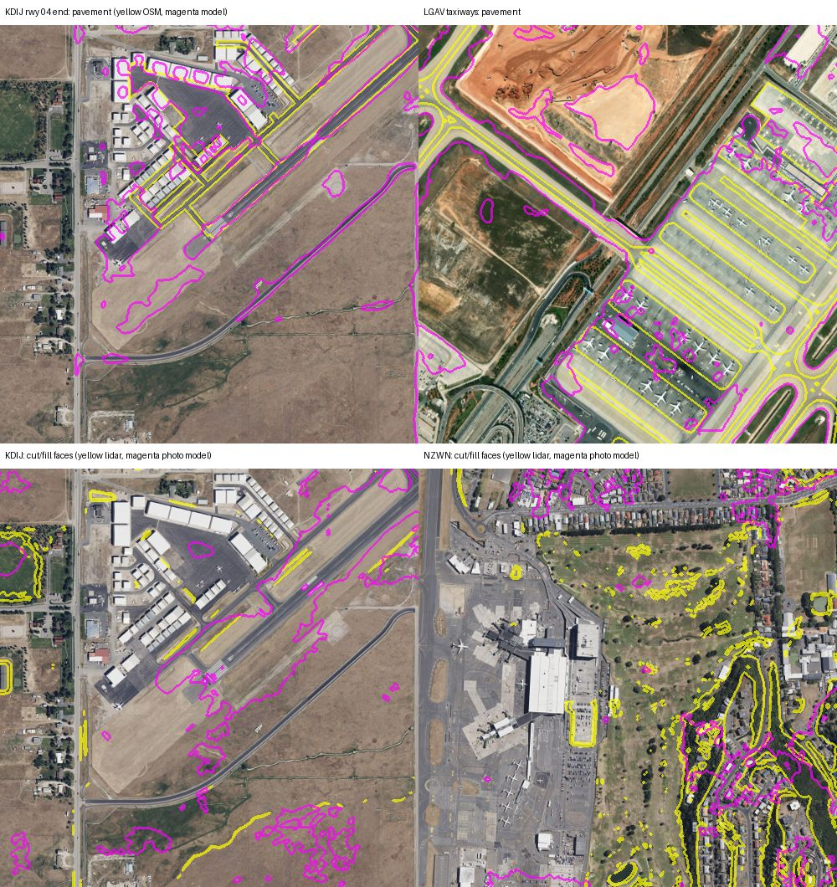

# #1359 option (b): a small trained image model for cut/fill edges, runway edges and tunnel portals

Feasibility study, 2026-10-27. Owner's Q172 answer: explore a trained image model on a feature branch, and fold it in only if the results are good. The multi-source "triangulation" (lidar, CIFP, apt.dat/pack layout, imagery) is a separate lane. Nothing here touches the engine, and builds on main are unchanged.

**Verdict:** don't fold the image model in as a cut/fill or portal witness. It is useful for one thing, **finding where pavement and graded ground are**, which is the image witness the triangulation lane needs. It can't measure slopes.

## What was built

- **Data.** These are saved files from the shared corpus (read only, no downloads): the ortho JPGs (ZL18 BI/Arc/USA2), the airport lidar insets (USGS 3DEP, Wales/England 1 m, France 1 m, NZ 1 m), and the OSM `*_airports` / `*_small_roads` / `*_big_roads` extracts. Everything is resampled onto one 2 m grid per airport ([`prep.py`](1359-image-model/prep.py), [`osmlabels.py`](1359-image-model/osmlabels.py)). An alignment check at KDIJ is good to about one pixel.
- **Train (20 airports):** EGGP EGNR KASE KBLU KBOI KCOS KCRW KDRO KEGE KGJT KJAC KMTJ KPUB KRNO KSEA KSUN KTVL LFMP NZCL NZMF.
- **Test (never seen):** KDIJ, NZWN, EGFF and KTRK, with lidar and photos. LGAV has photos only (its inset is Copernicus 30 m). **LFLL and KBUF have no saved orthophotos around the airport**, so they could not be tested.
- **Model.** A 4-level U-Net, 1.09 M parameters, trained on CPU in ~50 min ([`train.py`](1359-image-model/train.py)). Inference over a whole airport inset runs on CPU in under a minute (not timed precisely). It is plain PyTorch, and the weights could be exported to ONNX or to numpy for a dependency-free engine path.
- **Labels are free, never hand-drawn:**
  - **cut/fill face** = lidar slope > 10° (2 m grid, σ = 2 m smoothing);
  - **pavement** = OSM `aeroway=runway|taxiway|apron` (lines buffered by `width`, or by a 30/15 m default);
  - **tunnel portals** = end nodes of OSM `tunnel=yes` highway/railway ways.
- **Variants:**
  - photo only;
  - photo + 30 m DEM slope (trained on a 30 m lidar box-average, tested on both that and the real SRTM/Copernicus tile);
  - pavement (photo only).
- **Baselines:** the 30 m DEM slope thresholded on its own (4/6/8°, best shown), and a classic Sobel edge detector on the photo.
- **Metrics** are measured in the central 60 % of each inset: pixel IoU, and edge F-score (precision/recall of boundary pixels within 4 m and 10 m). Scripts: [`evalm.py`](1359-image-model/evalm.py), [`evalp.py`](1359-image-model/evalp.py). Raw numbers: [`metrics_cutfill.json`](1359-image-model/metrics_cutfill.json), [`metrics_pave_portal.json`](1359-image-model/metrics_pave_portal.json).

## Results

### 1. Cut/fill faces: the image model doesn't beat a 30 m DEM

| unseen airport | lidar steep share | photo only IoU / edge F@10 m | photo + 30 m DEM IoU / F@10 m | 30 m DEM alone (best thr) IoU / F@10 m | Sobel IoU / F@10 m |
|---|---|---|---|---|---|
| KDIJ | 1 % | 0.01 / 0.08 | 0.21 / 0.36 | 0.26 / 0.45 | 0.00 / 0.06 |
| NZWN | 21 % | 0.31 / 0.34 | 0.70 / 0.40 | 0.72 / 0.52 | 0.17 / 0.50 |
| EGFF | 11 % | 0.18 / 0.21 | 0.51 / 0.41 | 0.56 / 0.51 | 0.05 / 0.32 |
| KTRK | 7 % | 0.08 / 0.18 | 0.50 / 0.52 | 0.52 / 0.49 | 0.03 / 0.23 |

The "30 m DEM alone" column is a 30 m box-average of the lidar, which is optimistic. With the **real** fallback DEM the numbers drop: KDIJ SRTM sees no face at all (IoU 0.00), and NZWN SRTM scores 0.59 alone versus 0.57 with photo + DEM. The photo adds nothing measurable. A straight-down orthophoto carries almost no slope signal; what the model learns is colour and texture (fields, scrub, buildings). A fill face looks like the grass on either side of it. **The KDIJ mowed-edge case (#1358) is the worst case.** The fill there is gentle, under 10° and mostly under 3°. It shows only as a mowing or tone change, and no lidar label marks it as a face.

### 2. Tunnel portals: no

The test compares the peak model score within 24 m of each OSM tunnel end against 200 random points. AUC 0.5 is a coin flip.

| airport | portals | photo model AUC | lidar slope AUC | lidar sees a cut (>25°) |
|---|---|---|---|---|
| KDIJ | 2 | 0.23 | 1.00 | 2/2 |
| NZWN | 38 | 0.19 | 0.54 | 45 % |
| EGFF | 12 | 0.53 | 0.96 | 12/12 |
| KTRK | 2 | 0.14 | 0.18 | 0/2 (no cut; probably not a cut portal, unchecked) |
| LGAV | 16 | 0.26 | n/a | n/a |

Where lidar exists, it is the portal witness. The photo model can't tell a portal from anything else.

**The phantom sites score low, which is right:**
- NZWN #1337: model 0.36 and 0.43, lidar max slope 10–11°;
- LGAV #1331: model 0.30, and the pavement model reads 0.67 "paved" there, which agrees with the owner's "flat taxiway".

But the same model scores real portals low too, so these readings carry no information.

### 3. Runway/taxiway/apron outline: useful

These are scored within 100 m of mapped airport pavement. Over the whole inset, roads and parking lots also read as "paved".

| unseen airport | IoU | precision | recall | edge F@4 m | edge F@10 m | median edge offset |
|---|---|---|---|---|---|---|
| KDIJ | 0.46 | 0.54 | 0.76 | 0.33 | 0.67 | 5.7 m |
| NZWN | 0.43 | 0.45 | 0.90 | 0.23 | 0.51 | 10.0 m |
| EGFF | 0.57 | 0.58 | 0.96 | 0.15 | 0.57 | 8.2 m |
| KTRK | 0.55 | 0.58 | 0.91 | 0.20 | 0.47 | 10.2 m |
| LGAV | 0.42 | 0.44 | 0.91 | 0.14 | 0.32 | 18.9 m |

- Recall is high: 76–96 % of mapped pavement is found.
- Precision is held down by unmapped pavement and by **graded, mowed or bare ground next to the pavement, which the model also marks**. At KDIJ it outlines the pale graded strip beyond the runway 04 end (see the picture). That is the safety-area/graded edge, but no source maps it, so it can't be scored.
- The edge position is within about 6–10 m at three of five airports. That is good enough as a **witness** ("pavement or graded ground is here"), not as a survey line.
- The scores are capped by the labels: OSM widths are rough (KDIJ's runway is tagged 15 m wide).

**#1358 (KDIJ):** the model reads pavement at both pins:
- 0.85 at the apt.dat runway-04 end;
- 0.97 at the CIFP RW04 threshold, ~594 m NE, mid-runway.

In the photo, the asphalt ends at the apt.dat end, and pale graded ground runs on SW to the road. So the imagery agrees with apt.dat on where the pavement ends, and puts the CIFP threshold on the runway, as a displaced threshold would be. This is the kind of tiebreak the triangulation lane wants.

*Top: pavement (yellow = OSM, magenta = model) at the KDIJ 04 end and at the LGAV #1331 taxiways. Bottom: cut/fill faces (yellow = lidar > 10°, magenta = photo-only model) at KDIJ and NZWN.*

## Recommendation

1. **Don't add the model as a cut/fill or portal witness.** Lidar is the witness where it exists. Where it doesn't, the photo does not recover slopes, and a 30 m DEM does as well as the photo + DEM model.
2. **Offer the pavement/graded-ground model to the triangulation lane** as its image witness. It would vote on where pavement really ends when apt.dat, CIFP, packs and OSM disagree after a runway works project, and where the graded strip stops. It never becomes an authority over airside law. It needs:
   - a consumer census at spec time (RULINGS 2026-08-30l);
   - a decision on the runtime: an ONNX Runtime dependency, or a numpy-only port of the ~1 M-parameter network. **Adding a model dependency needs the owner's approval** (Q172 note);
   - better labels before it is trusted for edges: apt.dat pavement polygons instead of OSM lines, plus a hand-checked "graded strip" set at about 10 airports.
3. **Data gaps:** LFLL and KBUF have no saved orthophotos near the airport, so their cases (#1333, #1343) couldn't be tested. They need a ledgered `--refresh-data` imagery fetch on the Mac if the lane goes on.

The scripts here are research prototypes, kept for reproduction. They are not harness tools and are not in `tools/INDEX.md`. The trained weights are not committed (they were trained on provider imagery).
